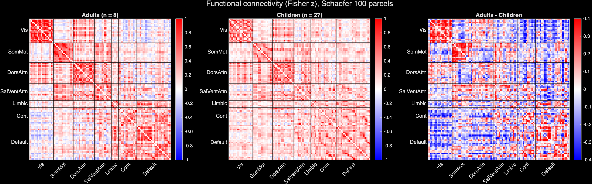
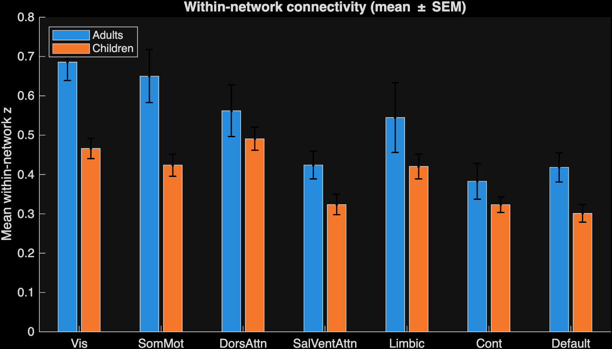
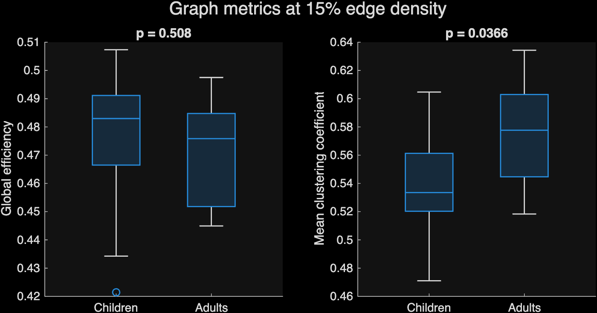
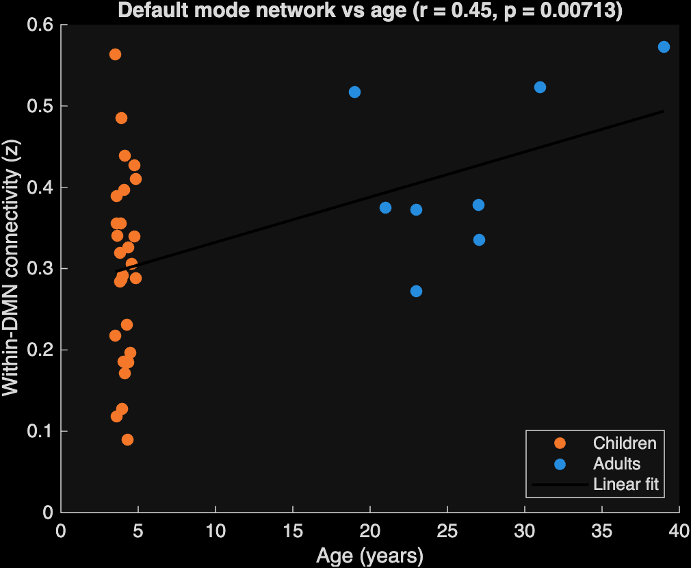

# Developmental Changes in Functional Brain Networks (MATLAB)

How does the large-scale functional organization of the brain differ between young children and adults? This project implements a functional connectivity pipeline in MATLAB and applies it to naturalistic (movie-watching) fMRI from children and adults. The goal is to test whether adult brain networks are more **segregated**, meaning more strongly connected within each network and less connected between networks, than those of young children.



## Key findings

| Measure | Result | Statistic |
|---|---|---|
| Within-visual connectivity | Adults > Children | t = 4.10, d = 1.62, **q_FDR = 0.043** |
| Visual–control connectivity | Adults < Children | t = −3.51, d = −1.20, **q_FDR = 0.043** |
| Within-DMN connectivity vs. age | Positive correlation | r = 0.45, p = 0.007 |
| Mean clustering coefficient | Adults > Children | t = 2.39, p = 0.037 (uncorrected) |
| Global efficiency | No difference | t = −0.68, p = 0.51 |

Together, these results show stronger within-network and weaker between-network connectivity in adults, consistent with increasing functional network segregation over development.

## Data

- **fMRI:** Preprocessed movie-watching fMRI from Richardson et al. (2018), *Nature Communications* (OpenNeuro ds000228). The data were preprocessed with fMRIPrep, are in MNI space, and were accessed through nilearn. Participants watched the short animated film *Partly Cloudy* during scanning.
- **Sample:** 40 participants (31 children aged about 3–5 years, 9 adults aged 18–39), drawn from the full dataset of 155.
- **Atlas:** Schaefer et al. (2018), *Cerebral Cortex*. It has 100 cortical parcels, each assigned to one of 7 Yeo networks: visual, somatomotor, dorsal attention, salience/ventral attention, limbic, control, and default mode (DMN).

## Pipeline

The analysis is in `run_connectivity.m`:

1. **Parcel time series.** Average the voxel signals within each atlas parcel, using a sparse-matrix operation over the 4D image.
2. **Nuisance regression.** Remove the intercept, linear trend, head-motion parameters, and tissue/CompCor confound signals.
3. **Band-pass filtering.** Keep 0.01–0.08 Hz, using a zero-phase FFT filter.
4. **Functional connectivity.** Compute Pearson correlations between all 4,950 parcel pairs, then apply a Fisher z-transform.
5. **Head-motion QC.** Compute mean framewise displacement (FD) per subject and exclude subjects with FD > 0.5 mm.
6. **Network-level statistics.** Average within- and between-network connectivity for all 28 network pairs, compare adults and children with Welch t-tests and Benjamini–Hochberg FDR correction, and correlate within-DMN connectivity with age.
7. **Graph theory.** Compute global efficiency and mean clustering coefficient on binary networks thresholded at 15% edge density.

All statistics are implemented from scratch in base MATLAB: Welch t-test, Pearson correlation p-values, FDR correction, and graph metrics. The only toolbox required is the Image Processing Toolbox, for `niftiread`.

## Results

After excluding five high-motion participants (four children, one adult), 27 children and 8 adults were analyzed.

**Network segregation.** Two network-level differences survived FDR correction. Adults showed stronger connectivity *within* the visual network (t = 4.10, d = 1.62, q = 0.043) and weaker connectivity *between* the visual and control networks (t = −3.51, d = −1.20, q = 0.043). Within-somatomotor (p = 0.012) and within-default-mode (p = 0.019) connectivity showed similar trends, as did weaker visual–default coupling in adults (p = 0.007, q = 0.062). None of these survived correction.



**Graph metrics.** Adults showed higher mean clustering (p = 0.037, uncorrected), with no group difference in global efficiency (p = 0.51). This is consistent with more locally organized networks without a loss of overall integration.



**Age effects.** Within-DMN connectivity correlated positively with age (r = 0.45, p = 0.007). However, the children in this subset span only about 3 to 5 years, and there are no participants between ages 5 and 18. This correlation therefore reflects the child–adult difference, not a continuous developmental trajectory.



## Limitations

- **Residual head motion.** Children moved more than adults even after exclusion (mean FD 0.36 vs. 0.22 mm). Motion is a well-known confound in developmental connectivity studies and may contribute to the group differences.
- **Small adult sample.** With n = 8 adults, the group comparisons are exploratory.
- **Age coverage.** The subset has no participants between about 5 and 18 years old.
- **Naturalistic stimulus.** The fMRI was recorded during movie watching, not true rest, so stimulus-driven activity contributes to the connectivity estimates.
- **Simplified denoising.** Filtering is applied after nuisance regression. A stricter pipeline would filter the confound regressors as well.

## Next steps

- Include mean FD as a covariate in a regression model with age as a continuous predictor.
- Run on the full dataset (155 participants, children aged 3–12) to cover middle childhood.
- Add modularity analysis and edge-wise network-based statistics.
- Extend to longitudinal data to model within-subject developmental change.

## How to run

**Requirements:** Python 3 with `nilearn` and `pandas`; MATLAB R2020a or later with the Image Processing Toolbox.

1. Download the data and atlas. This creates the `./data` folder:
   ```bash
   pip install nilearn pandas
   python Datafile.py
   ```
2. In MATLAB, from the project folder, run:
   ```matlab
   run_connectivity
   ```

## Repository structure

```
├── Datafile.py            # downloads fMRI data and atlas, writes manifest
├── run_connectivity.m     # full MATLAB analysis pipeline
├── figures/               # output figures (PNG)
├── network_stats.csv      # network-level group statistics
└── subject_metrics.csv    # per-subject motion, connectivity, graph metrics
```

The `data/` folder is created by `Datafile.py` and is not included in the repository.

## References

- Richardson, H., Lisandrelli, G., Riobueno-Naylor, A., & Saxe, R. (2018). Development of the social brain from age three to twelve years. *Nature Communications*, 9, 1027.
- Schaefer, A., et al. (2018). Local-global parcellation of the human cerebral cortex from intrinsic functional connectivity MRI. *Cerebral Cortex*, 28(9), 3095–3114.
